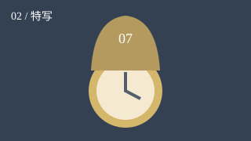
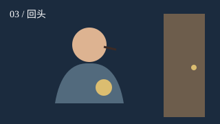
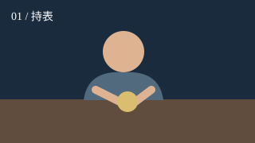

# 《七号怀表》分镜示例

虚构示例 · 第 1 集 · 修复室 · 夜 · 9:16 竖屏

人物与道具：林岚是一名修表师，一只带翻盖的怀表贯穿三个镜头。

| 镜号 | 分镜草图 | 景别 / 运镜 | 画面与动作 |
| --- | --- | --- | --- |
| 01 |  | 中近景，缓推 | 林岚拿起怀表。 |
| 02 | 局部： 表盖朝向镜头 | 特写，固定 | 左手托表，右手打开表盖。 |
| 03 |  | 中景，固定 | 听到敲门声，林岚回头。 |
| 04 | .svg) | 近景，固定 | 素材文件名可以带括号。 |
| 05 | 引用式：![怀表近景][watch-close] | 特写，固定 | 多处可以共用同一张素材。 |

[watch-close]: ./storyboard-shots/02.svg "怀表近景"

资料引用也可以使用引用式链接，例如[示例资料][source-example]。

[source-example]: https://example.com/ "示例资料"

工作区内可打开同目录的[分镜资料](./分镜资料.md)和[示例合同][contract]；两个链接以当前 Markdown 文件目录为基准。

也可以直接跳到[资料中的镜头说明](./分镜资料.md#镜头说明)，或跳到本页的[互动示例](#互动示例)。

[contract]: 示例合同.rtf

同一行也可以先写文字，再放图片：怀表  的表盖刻着 07。

本地图片和媒体链接可以带 `?v=1` 这样的版本参数；本地预览仍读取文档旁的原始文件，保存时保留原写法。

在这份工作区文档中插入图片，图片会保存在当前目录的 `assets` 文件夹，并使用 `./assets/...` 引用。选中本地图片后，可通过工具栏上传到本机 PicGo 配置的图床；正文或表格中与文字混排的图片也可点击后上传。上传成功后，本地图片仍会保留。

图片也可以直接以 Base64 数据嵌在 Markdown 中：。

### HTML 图片写法

也可以使用相对路径的 HTML 图片标签；编辑周围文字时会保留原始标签。



| 镜号 | 画面 |
| --- | --- |
| 02 | 特写  表盖朝向镜头 |

## 互动示例

Windows 桌面端可直接播放视频并运行下方 Canvas 游戏；打包为 `.mdxb` 后也可在 Web 阅读器中运行。二次函数画布支持拖动滑块。

表格单元格也可以直接放单行视频、音频或 Canvas，媒体文件可以用 `./` 或不带 `./` 的相对路径。视频可用 `#t=0,1` 指定播放片段。单元格里的竖线需要写成 `\|`。

| 镜号 | 动态参考 |
| --- | --- |
| 01 | <video controls preload="metadata" src="./示例视频.mp4" poster="./storyboard-shots/02.svg">当前环境无法播放视频</video> |
| 02 | <canvas id="table-game" width="260" height="120"></canvas><script>const c=document.getElementById('table-game'), x=c.getContext('2d'); let n=0; function draw(){x.fillStyle='#e9eef5';x.fillRect(0,0,260,120);x.fillStyle='#304d72';x.font='20px sans-serif';x.fillText('Click: '+n,20,65);} c.onclick=()=>{n++;draw();};draw();</script> |
| 03 | <video controls poster="./storyboard-shots/02.svg"><source src="示例视频.mp4#t=0,1" type="video/mp4"></video> |
| 04 | <audio controls><source src="./示例音频.wav" type="audio/wav"></audio> |

<video controls preload="metadata" src="./示例视频.mp4" poster="./storyboard-shots/02.svg">当前环境无法播放视频</video>

场景音频也可直接播放：

<audio controls src="示例音频.wav"></audio>

### 三维道具

<model-viewer src="./示例模型.obj"></model-viewer>

```mdxb-canvas
{"title":"调整二次函数","height":360,"source":"{\"kind\":\"quadratic\",\"a\":1,\"b\":0,\"c\":0}"}
```

### 点击星星

<canvas id="game" width="300" height="140" style="background:#142039;cursor:pointer"></canvas>
<script>
let n = 0, c = document.getElementById('game'), x = c.getContext('2d');
let score = document.createElement('p');
c.insertAdjacentElement('afterend', score);
function draw() { x.clearRect(0, 0, 300, 140); x.font = '48px sans-serif'; x.fillText('⭐', 120, 82); score.textContent = '点击画布得分：' + n; }
c.onclick = () => { n++; draw(); };
draw();
</script>

### 画布加载分镜图片

脚本使用 `new Image()` 和推荐的 `./storyboard-shots/01.svg` 相对路径加载分镜，点击画布记录镜次；打包和导出时图片会一并嵌入。

<canvas id="image-slate" width="300" height="140"></canvas>
<script>
const imageSlate = document.getElementById('image-slate');
const storyboardImage = new Image();
storyboardImage.onload = () => {
  imageSlate.getContext('2d').drawImage(storyboardImage, 0, 0, 300, 140);
  const note = document.createElement('p');
  let count = 0;
  imageSlate.after(note);
  const render = () => { note.textContent = 'score: ' + count; };
  imageSlate.addEventListener('click', () => { count++; render(); });
  render();
};
storyboardImage.src = './storyboard-shots/01.svg';
</script>

### 外置脚本与样式

这个场记板使用同目录的脚本和样式文件，点击画布记录镜次。

<canvas id="slate" width="300" height="140"></canvas>
<link rel="stylesheet" href="./storyboard-game.css">
<script src="storyboard-game.js"></script>

上方视频与模型会随书籍打包；Windows 桌面和 Web 阅读器均可播放视频并旋转模型。工作目录中的媒体文件也可分别打开预览。

### 内联样式与相对图片

画布的背景和边框分别来自内联样式与样式块，点击画布记录镜次。

<canvas id="inline-scene" width="300" height="140" style="background-image:url('./storyboard-shots/01.svg');background-size:cover;cursor:pointer"></canvas>
<style>#inline-scene { border: 8px solid transparent; border-image: url(storyboard-shots/02.svg) 20 round; }</style>
<script>
let inlineCount = 0, inlineCanvas = document.getElementById('inline-scene');
let inlineScore = document.createElement('p');
inlineCanvas.insertAdjacentElement('afterend', inlineScore);
function updateInline() { inlineScore.textContent = '内联镜次：' + inlineCount; }
inlineCanvas.onclick = () => { inlineCount++; updateInline(); };
updateInline();
</script>


### 列表中的音频

- <audio controls>
  <source src="./示例音频.wav" type="audio/wav">
  </audio>

### 容器中的场记板

常见网页片段可以用容器包住画布，再引用同目录的样式和脚本。画面也可使用 `srcset` 按屏幕密度选择分镜图，两种相对路径写法都以本文档目录为基准。

<div class="storyboard-wrapper">
  <div class="stage"><canvas id="slate" width="300" height="140"></canvas></div>
  <picture><source srcset="./storyboard-shots/01.svg 1x, storyboard-shots/02.svg 2x"></picture>
</div>
<link rel="stylesheet" href="./storyboard-game.css">
<script src="storyboard-game.js"></script>

### 模块化场记板

模块脚本使用相对路径加载同目录的辅助模块和分镜图片；脚本地址也可带版本查询参数，点击画布记录镜次。

<canvas id="slate" width="300" height="140"></canvas>
<link rel="stylesheet" href="./storyboard-game.css">
<script type="module" src="module-game.mjs?v=1"></script>

### 读取本地分镜数据

画布通过 `fetch('./storyboard-data.json')` 读取文档旁的示例数据，点击后更新镜次；打包时本地数据会一并嵌入。

<canvas id="data-slate" width="300" height="140"></canvas>
<script>
fetch('./storyboard-data.json').then(response => response.json()).then(data => {
  const canvas = document.getElementById('data-slate');
  const note = document.createElement('p');
  let count = data.initial;
  canvas.after(note);
  const render = () => { note.textContent = data.label + count; };
  canvas.addEventListener('click', () => { count++; render(); });
  render();
});
</script>
