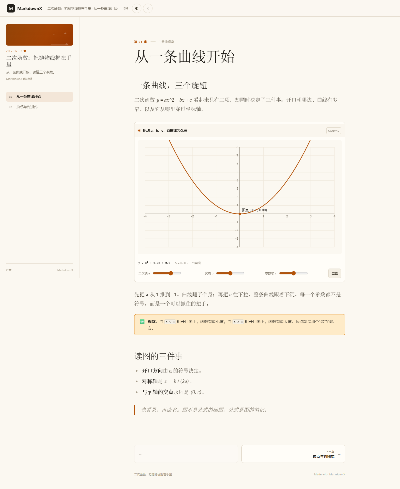

<h1 align="center">MarkdownX</h1>

<p align="center">
  <b>书不该只是读到这里。</b><br>
  给下一代学习者的可交互书本：桌面创作端 + 浏览器阅读端。
</p>

<p align="center">
  <a href="https://github.com/neko233-com/MarkdownX/actions/workflows/ci.yml"></a>
  <a href="LICENSE"></a>
  <a href="README.md">English</a>
</p>



## 它是什么

MarkdownX 用来写和读**动态书**：一本可以拖动的抛物线、可以推一把的单摆、可以点的测验、可以排序的表格，或者一整段 HTML 小实验。

- **写一次，到处能读。** 一本书就是一个 `.mdxb` 文件，文字、图片和交互块都在里面，不需要服务器，也不怕资源散落。
- **Markdown 与飞书 DocxXML。** 工作目录可直接编辑常用 Markdown 和 `.docxxml`，也可以导入已授权的飞书文档。Typora 格式兼容仍在完善。
- **交互块。** 二次函数、单位圆、抛体 Canvas 可在桌面和 Web 阅读器运行；HTML/JS 在 Windows 桌面和阅读器的沙箱中运行，可嵌入本地数据，外部网络连接受到限制。
- **原生中英双语。** 界面、书名和章节正文都可以同时带中文和英文。
- **为屏幕而生的阅读器。** 手机单列，桌面目录 + 正文；无构建步骤，Chrome 直接打开。
- **本地优先。** 本地编辑无需登录；飞书导入使用可选的 CLI 授权，工作目录保存在自己的电脑上。
- **文件夹就是工作区。** 打开任意目录，直接编辑里面的 `.md`；同一个目录树也能放 `.mdxb`。侧栏是目录树，支持模糊路径搜索和可开关的内容搜索。
- **批注在正文旁边。** 临时批注保存为 `.annotations.json` sidecar，可以隐藏、解决、批量操作和合并，不必改动正文。
- **跟着你的电脑走。** 首次启动跟随系统语言（中文/English），也可以在设置里固定一种；应用启动后和每 12 小时检查 GitHub 发布页，发现新版本会提示下载地址。

## 两种用法

| 创作 | 阅读 |
|---|---|
| GPUI 桌面端：打开文件夹、编辑 `.md`、插入 Canvas/HTML、写批注，再打包 `.mdxb`。 | `web/` 里的 Chrome 阅读器：打开书、翻章、缩放窗口、切换语言和主题。 |

| 首页 | 可交互章节 |
|---|---|
|  |  |

## 安装发布版

以下命令需要对应 GitHub Release 已发布。Windows 正式版提供 x86_64 MSI；历史 macOS 测试预发布版的 Apple Silicon DMG 为临时签名，尚未经过 Apple 公证。应用内更新检查只提示正式版，不提示测试预发布版。

Windows x86_64（PowerShell 7，安装到当前用户）：

```powershell
irm https://raw.githubusercontent.com/neko233-com/MarkdownX/main/install.ps1 | iex
```

macOS arm64（Apple Silicon）：

```sh
curl -fsSL https://raw.githubusercontent.com/neko233-com/MarkdownX/main/install.sh | sh -s -- --allow-unsigned
```

安装脚本会校验安装包；Windows 会请求应用正常保存并退出，保留文档库及协作服务器数据。macOS 安装到 `~/Applications/MarkdownX.app`，请先关闭正在运行的旧版。未公证测试版首次启动时，macOS 可能阻止打开；确认信任后，可在「系统设置 → 隐私与安全性」中检查提示并允许打开。脚本不会修改 Gatekeeper 设置。离线安装时下载 MSI 或 DMG 与其 `.sha256`，运行 `pwsh -File ./install.ps1 -MsiPath <文件>` 或 `sh ./install.sh --package <文件> --allow-unsigned`；添加 `-DryRun` 或 `--dry-run` 可只检查。Windows Git Bash 可通过 `sh ./install.sh` 调用 PowerShell 7。

发布默认在本地验证、打包后直接上传 GitHub Releases。推送版本标签不触发自动发布。可选的 **Actions → Release** 工作流仅作为跨平台测试版的显式后备，需要选择已有标签并输入 `PUBLISH vX.Y.Z`。

## 快速开始

需要 Rust 1.99.1；Windows 还需要 Visual Studio 2022 的 C++ 生成工具和 Windows SDK。Python 3 只用于示例和本地静态服务器。

```sh
cargo run --release
```

Windows 请在 Visual Studio 开发者命令行里构建，或先调用 `vcvars64.bat`。

在当前 Windows 用户下安装构建好的版本（开始菜单/桌面快捷方式、`.mdxb` 文件关联）：

```powershell
pwsh -File scripts/install-windows.ps1
```

不需要管理员权限。优先使用当前构建的 MSI；应用装到 `%LOCALAPPDATA%\Programs\MarkdownX`，服务器令牌和工作区保留在 `%LOCALAPPDATA%\MarkdownX\server`，并在「应用和功能」中管理。安装脚本不会强制结束运行中的安装版应用或服务器。

release 构建后运行 `pwsh -File scripts/build-msi.ps1`，生成 `dist\MarkdownX-<version>-x64.msi`。MSI 会装好应用、可选协作服务器、Web UI、模板、快捷方式和 `.mdxb` 关联；协作服务仅在主动打开「MarkdownX Collaboration」时启动，不随登录启动。内置本机阅读器按需启动，仅提供应用内置的静态资源。构建时只需要 WiX Toolset 3.14。

「我的文档」默认显示系统文档目录下的 `MarkdownX-Demo`；Windows 通常为 `C:\Users\<用户名>\Documents\MarkdownX-Demo`。目录不存在时自动创建。使用「我的文档」旁的加号、设置或 **文件 → 打开文件夹…** 添加多个目录，各目录树同时显示并在重启后恢复。目录旁的「…」可更改显示名称或目录、刷新、移除工作区；移除只影响列表，不删除磁盘文件。不可用的目录会保留提示，不影响其他目录。启动参数指定的文件夹仅本次生效。

首次启动时，空的默认目录会生成与界面语言一致、可直接编辑的示例，并同时在编辑区和目录树中显示；文档库指南也使用相同语言。已有文件不会被覆盖，启动参数指定的文件或目录优先打开。切换界面语言不会翻译或覆盖已有文档；已保存工作区中最后打开的文件仍然可用时会在重启后恢复。

已有工作区的用户可在 **设置 → 文档 → 创建演示** 选择保存位置。应用会创建一个独立的 `MarkdownX-Demo` 文件夹；如果同名文件夹已存在，会使用新名称，不覆盖现有内容。

目录树显示普通文件，并用适配深浅主题的图标区分文件夹、Markdown、文本、书籍、代码和图片等类型；其他类型可从文件菜单或全局搜索结果选择「使用系统应用打开」。文件名搜索覆盖可见文件，正文搜索只读取支持的文档；隐藏项、符号链接及构建依赖目录不显示。

设置 › **扩展** 会列出内置格式和已安装的外部扩展。扩展是应用数据目录 `markdownx/plugins` 下带 `plugin.json` 的文件夹（可用 `MARKDOWNX_PLUGIN_DIR` 覆盖），程序必须位于该文件夹内。打开匹配后缀的文件时，应用启动扩展并索取 Markdown，以只读预览显示，不会改写原格式。「安装扩展…」会把选中的文件夹复制到该目录，可逐个关闭扩展；与内置格式或其他扩展冲突的清单会整体跳过。仓库中的 `MarkdownX-Demo` 目录包含 Markdown、Excel 示例和一个参考扩展。

图片（含动态 GIF）、音频、视频和 3D 模型可直接预览：图片可缩放，音频显示解码后的波形与时长，视频显示系统缩略图和元数据，OBJ/STL/glTF/GLB 可拖动旋转和缩放。音频和视频还可选择「使用系统应用打开」。它们和外部扩展共用同一套后缀注册表，插件不能静默占用这些后缀。

Windows 可使用系统 PDF 渲染器逐页只读预览 PDF，并通过缩放按钮放大、滚动查看细节。首页、末页和上一页、下一页按钮支持快速翻页，也可使用 Page Up、Page Down、Home、End；Ctrl 加 `+`、`-` 或 `0` 可缩放和复位。使用 Ctrl+F 或「查找文字」可按页检索并跳转匹配页，暂不高亮页内文字；扫描件、特殊字体或提取失败的页面可能无法检索，并会提示没有文字或提取失败的页数。普通 CAJ 或扩展名为 CAJ 的 PDF 会先在内存中转换后预览和检索，原文件不变。转换支持取决于 CAJ 版本；KDH、HN/C8、受保护或损坏的文件需要其他应用。预览暂不支持文字选择、OCR 和批注；演示工作区提供三页的 `论文阅读示例.pdf`。

工作区 Markdown 的本地图片以该 Markdown 文件所在目录为基准解析，`./shots/01.svg` 和 `shots/01.svg` 都可使用，推荐前一种写法。正文和表格单元格支持文字与图片混排，包括 SVG 分镜图和单行 ``；独立 HTML 图片标签也可跨行书写并支持像素宽高，行内图片按行内布局缩放。编辑周围普通文本时保留原始引用和 HTML 属性，图片标签中的事件处理器不会运行。独立的音视频、模型和 HTML 游戏也可在 Windows 桌面文档内使用；包含这些媒体的完整 HTML `div`（包括嵌套容器）可作为互动块运行；表格单元格可放完整的单行音视频或 Canvas 标签、媒体容器及其脚本，单元格中的竖线写成 `\|`。其他嵌入写法尚未全部支持。

桌面预览也支持 Base64 编码的 `data:image/...` 图片（PNG、JPEG、GIF、WebP、BMP 和 SVG），包括正文和表格内的图片；单张解码后不超过 20 MB。Markdown 导出保留原始数据，内置 HTML 和 PDF 导出使用同样的图片校验。嵌入式 SVG 中的外部文件引用不会被加载，图中的文字需要系统具备可用字体。

论文 Markdown 支持行内 `$...$` 公式和单行或多行 `$$...$$` 独立公式；桌面预览、书籍和内置 HTML/PDF 导出保留公式源码，编辑独立公式后仍使用独立公式格式。网页阅读器使用离线 KaTeX 生成 MathML，支持嵌套分数、根号、上下标、求和和积分；浏览器需支持 MathML。无效或超过 16384 字符的网页公式显示源码，代码块中的公式标记保持原样。 公式中看似图片、链接或脚注的文本保持原样，不会被当作资源引用打包。

PDF 是静态文档：内置导出会为单独的视频显示封面（如果提供）和播放提示，为音频显示播放提示，并尽可能保留 HTML 画布的初始画面；需要交互时请查看 HTML 或 MarkdownX 原文。

图片文件名可以包含配对括号，例如 `.svg)`；含空格的路径可用尖括号包住，例如 ``。这两种写法也能随书籍打包并在 Web 阅读器显示。

命令行可将 Markdown 转换为独立 HTML 或 PDF：

```powershell
markdownx convert .\分镜与互动演示.md --to html
markdownx convert .\分镜与互动演示.md -o .\分镜.pdf --strategy builtin
markdownx convert .\分镜与互动演示.md -o .\分镜-pandoc.pdf --strategy pandoc --pdf-engine typst
markdownx convert .\论文引用示例.md -o .\论文.html --citeproc
markdownx convert .\论文引用示例.md -o .\论文.pdf --citeproc
markdownx convert .\论文.md -o .\论文.docx --citeproc --bibliography .\参考文献.bib --csl .\期刊样式.csl --reference-doc .\论文模板.docx
```

`auto` 默认使用内置 HTML 渲染器；PDF 依次尝试本机 Edge/Chrome 等 Chromium 浏览器，找不到可用浏览器时尝试 Pandoc；如果 `pdflatex` 不可用或失败，回退时会尝试 Typst。DOCX、ODT、RTF、EPUB 使用 Pandoc。Windows x64 优先使用 `PATH` 中的工具；需要时会将固定版本、经 SHA-256 校验的 Pandoc 和 PDF 所需的 Typst 下载到当前用户的本地应用数据目录。默认缓存位置为 `%LOCALAPPDATA%/markdownx/format-tools`，可通过 `MARKDOWNX_FORMAT_TOOLS_DIR` 覆盖；设置 `MARKDOWNX_FORMATS_OFFLINE=1` 可禁用下载；其他平台需要另行安装。使用 `--citeproc` 时，`auto` 用 Pandoc 处理引文：HTML 直接由 Pandoc 生成，PDF 优先将生成的 HTML 交给浏览器打印；也可用 `--pdf-engine typst` 等选项直接指定 Pandoc PDF 引擎。`builtin` 固定使用内置渲染，`pandoc` 固定使用 Pandoc（生成 PDF 还需要其 PDF 引擎）；`--browser PATH` 可指定浏览器，不能与 `--pdf-engine` 同时使用；auto PDF 可用 `--no-browser` 跳过浏览器并使用 Pandoc 回退。DOCX/ODT 可通过 `--reference-doc` 指定同格式的样式模板；`--citeproc` 可读取文档元数据，也可用 `--bibliography` 和 `--csl` 指定本地文献库及引用样式，命令行路径相对于运行命令的目录。引用处理出现 Pandoc 警告时转换失败，避免静默交付缺失引文的文档。内置策略将本地图片、HTML 交互资源和样式打包进 HTML；内置 HTML 和浏览器打印 PDF 会将有引用的顶层 Markdown 脚注排成带返回链接的注释，网页阅读器的 Markdown 格式章节也支持脚注和返回链接；内置 HTML/PDF 和网页阅读器保留带脚注标题的原始锚点（包括重名标题）；网页中 Markdown 与 DocxXML 的图片、公式标题按图片替代文字和公式源码生成锚点；桌面 Markdown 的阅读模式可查看顶层脚注、跳转和返回引用，并保留指向带脚注标题的原始锚点，编辑模式及 DocxXML 格式章节仍显示脚注原文，不支持或未引用的定义保留原文；HTML 中指向资源根内文件的链接按导出目录重新计算，即使目标尚未创建也保留其相对源文件的位置；越界或经过符号链接的相对链接会使转换报错，可用 `--root` 扩大资源根目录，同盘优先使用相对路径；跨盘时内置和 Pandoc 使用指向本机原位置的文件 URL，PDF 阅读器可能限制打开本地文件。PDF 是打印时的静态结果，内置 `mdxb-canvas` 暂显示占位；Pandoc 导出的文档不保留 MarkdownX 的交互运行时。资源默认限制在 Markdown 所在目录，`--root DIR` 可指定更大的资源目录；Pandoc 按自身规则读取资源，`--root` 是额外搜索目录。输出已存在时需要 `--force`。Windows 安装包提供终端入口；安装后新开终端使用 `markdownx`。

打开 Markdown 后可用顶部眼睛按钮或 Ctrl+Alt+V 进入只读阅读模式，使用铅笔按钮或 E 返回编辑；切换前会先保存，阅读时批注暂不可用，原文与撤销历史保留。网页阅读器支持 Markdown 嵌套列表和起始编号；桌面端正确解析中文编号及制表符缩进，修改嵌套列表中的简单文字（包括与粗体、引用式图片等同行的普通文字）时保留原始图片引用和缩进；遇到无法唯一对应的原文仍会阻止有损保存。列表项中可直接嵌入本地音视频与 Canvas 互动内容。缩进代码块和围栏代码中的图片写法按代码保留，不会尝试读取示例路径；脚注正文和列表内容中的真实相对路径图片仍会读取和打包。

本地 Markdown 图片和 HTML 音视频可以带 `./frame.svg?v=1` 一类查询参数；读取时忽略查询参数，原 Markdown 保持不变。HTML 音视频的 `src` 也支持 `./clip.mp4?v=1#t=2,5` 这样的时间片段，可用于桌面预览、打包书籍和内置 HTML 导出；实际播放效果取决于媒体和播放器。文件名中实际的 `?` 和 `#` 应使用百分号编码。本地脚本也支持 `./game.mjs?v=1` 一类查询参数；桌面预览、书籍和内置 HTML 导出按浏览器规则规范化模块查询，中文与等价的百分号编码共享同一个模块实例。SVG 图片可用 `./frame.svg#view` 选择命名视图；桌面端支持视口、`preserveAspectRatio` 和渲染引擎支持的选择器中的 `:target`，其他视图规格与 CSS 仍有限制。

也可使用引用式图片，例如 `![画面][镜头]` 配合单行定义 `[镜头]: ./shots/01.svg`，支持引用在定义之前、空标签及同名简写。打开和编辑保留原始定义；单独上传引用式图片时，仅该图片改为上传后的直接链接，其他引用继续使用原定义。

网络引用链接也支持相同的单行定义方式，例如 `[论文][来源]` 配合 `[来源]: https://example.com/`。桌面工作区中的直接链接和引用链接可打开 Markdown、PDF、合同及其他已支持的同目录或工作区内文件；路径以当前文件所在目录为基准，支持 `./文档.md` 和 `文档.md`。目标必须存在且位于工作区内。Markdown 和 DocxXML 可使用 `#标题` 或 `./文档.md#标题` 跳到标题；重复标题从第二个起使用 `-1`、`-2` 等后缀。Windows 对 PDF 和支持的 CAJ 可以用 `./论文.pdf#page=2` 跳到指定页，页码从 1 开始；页码不存在时会提示并显示第一页。文件夹打包的书籍保留章节来源路径，桌面导入及 Web 阅读器可跳转到已打包的章节和标题；旧书没有来源路径时不能自动定位其他章节。导出 Markdown 文件夹时，文档库中的本地 PDF 链接也会复制到导出目录，Markdown 和 DocxXML 源均保留页码，便于移动和重新打包。新打包的书籍会同时嵌入章节和译文中的本地 PDF 链接，并保留可选的 `#page=2` 页码；单个 PDF 不超过 16 MiB，必须位于书籍目录内。桌面导入后在 Windows 只读预览中打开；Web 阅读器使用浏览器打开嵌入副本，不修改源 PDF。其他非章节文件链接、查询参数及其他 PDF 片段尚未支持。

在工作区 Markdown 中插入、粘贴或拖入图片时，图片默认保存在文档旁的 `assets` 目录，新写入的链接采用 `./assets/...`；已有链接不强制改写。选中本地图片后可在图片工具栏选择「上传到 PicGo 图床」，正文或表格里与文字混排的图片也可点击后上传。应用连接本机运行的 PicGo，使用其当前图床配置，成功后替换该图片链接，保留本地图片；如果上传期间图片或所在文字发生变化，则不会覆盖新的编辑。默认地址为 `http://127.0.0.1:36677/upload`，可在「设置 → 通用 → 图片上传」修改本机地址及配置参数；非空的 `MARKDOWNX_PICGO_ENDPOINT` 环境变量优先。启用 PicGo 服务认证时通过环境变量 `PICGO_SERVER_SECRET` 提供令牌，设置中不保存令牌。上传由用户主动触发，不会自动上传本地图片。

`.docx`、`.docm`、`.dotx`、`.dotm`、`.odt`、`.ott`、`.rtf` 可打开只读的正文文本预览。Windows 还会为符合限制的 DOCX、DOCM、DOTX、DOTM 提供沙箱版式预览，包含常见表格和图片，提取的文字保留在下方；文件超过 16 MiB、解压后超过 128 MiB、条目过多或结构不受支持时回退到文本预览。版式预览不保证与原文完全一致，也不执行文档中的宏或外部 HTML；文字回退会标识可提取的插入和删除修订，并附上识别到的脚注、尾注、批注及页眉页脚，缺失的关联内容会提示。RTF 支持常见编码并包含隐藏文字，文件上限为 8 MiB，过于复杂的文件也会拒绝预览。`.ofd` 可提取只读页面文本；Windows 对符合相同压缩包限制的文件还提供离线沙箱版式预览和翻页，复杂对象与数字签章可能缺失，诊断信息会显示在预览内；`.tex`、`.ltx`、`.sty`、`.cls`、`.bst`、`.bib`、`.ris`、`.enw`、`.nbib`、`.csl`、`.rmd`、`.qmd` 和 `.typ` 可查看 UTF-8 只读源文本。OFD 页面可能仅含图片或使用特殊字体映射，提取的文字可能缺失或顺序有误；预览可能省略排版、图片、批注或签章，也不验证数字签名，不能代替原版核对。Windows 还支持旧版 `.doc`、`.dot` 的只读文字预览：通过受内存与时间限制的子进程提取正文、脚注、尾注、可识别的修订及部分页眉页脚，输入上限为 32 MiB；加密、损坏或不受支持的文件需要其他应用。文字、顺序和格式可能不完整，应以原件为准。演示工作区提供 DOC、DOCX、RTF、OFD、Quarto、带相对路径文献库的 Markdown 论文与分镜示例；论文及文献均为虚构演示。

Windows 可只读预览 EPUB：按书中章节顺序显示文字、本地图像、常见表格、MathML 和经过过滤的静态 SVG，输入上限为 32 MiB。为隔离不可信内容，电子书脚本不会运行；样式、链接、动画和部分内容可能缺失。含 `META-INF/encryption.xml` 的 EPUB（包括混淆字体）当前需要其他阅读器；预览不修改原件。演示工作区包含 `电子书论文示例.epub`。

HTML 互动块中，图片和 `<source>` 的 `srcset` 可使用章节目录下的相对图片；桌面、电子书阅读器和内置 HTML/PDF 导出会分别解析或嵌入这些图片，保留尺寸描述符。推荐以 `./` 开头，也支持不带 `./` 的相对路径。

Markdown 中可直接写独立的 `<video src="./clip.mp4" controls></video>`、`<audio>` 或 `<canvas>`；紧随其后的脚本与样式会在 Windows 桌面和 Web 阅读器的沙箱运行。`<script src="./game.js"></script>` 和 `<link rel="stylesheet" href="./game.css">` 可引用当前 Markdown 目录内的文件。外置 CSS 中的本地 `url()` 图片、字体和嵌套 `@import` 按样式文件所在目录解析；HTML 的 `style` 属性和 `<style>` 样式块中的相对资源按章节目录解析，打包时一并嵌入。缺失、循环引用或超出工作区的依赖会报错。`<script type="module">` 及外置模块中的静态相对导入、重导出和字符串字面量 `import()` 会递归打包，路径基于引用它的模块；普通脚本中的字面量 `import()` 也按脚本所在目录打包；模块导入需按 JavaScript 标准使用 `./` 或 `../`。字符串字面量形式的 `new URL("./frame.svg", import.meta.url)` 也会将模块旁的本地资源嵌入，可用于图片和媒体；`frame.svg` 与 `./frame.svg` 都支持。资源的查询参数不改变嵌入内容，SVG 片段保留。内联或外置 JavaScript 中的字面量 `fetch("./data.json")` 和 `fetch("data.json")` 会将文档目录中的本地数据嵌入；`fetch(new URL("./data.json", import.meta.url))` 则按模块目录解析。常见 Canvas 脚本中的 `const image = new Image(); image.src = "./frame.svg"`、同一代码块内 `document.createElement("img")` 配合 `setAttribute("src", ...)`，以及 `new Audio("./sound.mp3")` 的字面量资源也会嵌入，路径以 Markdown 所在目录为基准；计算式路径及跨代码块赋值暂不解析；脚本中存在同名自定义绑定时，会保守跳过相关自动嵌入。脚本请求只能读取嵌入的 data URL，外部网络仍被阻止。计算式 fetch 路径、循环导入、转义路径和非常量动态导入尚不支持。Windows 桌面使用 WebView2；macOS 和 Linux 的 HTML 仍需 Web 阅读器。Windows MSI 安装本机 Web 阅读器，协作服务运行时可从 `http://127.0.0.1:8877/reader/` 打开；先把文档打包为 `.mdxb`，再在阅读器中选择该文件。

独立的 `<model-viewer src="./model.glb"></model-viewer>` 支持 OBJ、STL、glTF 和 GLB。桌面可在文档内拖动旋转、滚轮缩放；Web 阅读器还提供旋转与重置按钮。打包 glTF/GLB 时会一并嵌入本地缓冲区与纹理。桌面模型使用简化几何预览，暂不显示材质、纹理和动画；Web 的 OBJ 材质库以及 Draco/KTX2 等需额外解码器的模型尚不支持。

从文件夹打包时，能识别的 Markdown 翻译图片按翻译文件所在目录解析并嵌入书中。Agent CLI 同样会嵌入能识别的章节相对图片，并拒绝缺失或位于书籍目录外的本地图片；代码示例保持原样。浏览器阅读器支持显示正文及表格单元格里的内嵌 Markdown 图片。DocxXML 正文和译文中新加入的相对图片、封面与附件按对应源文件目录解析，只要位于书籍目录内即可打包。

工作目录中的 `.xlsx`、`.xlsm` 和 `.xlam` 可在表格编辑器中打开，也可从工作目录新建 `.xlsx`。目前支持单元格编辑、可用公式的本地试算、撤销重做、区域复制填充、工作表管理，以及在当前工作表中查找，并分别替换文本、公式原文和数值；替换可选择区分大小写或匹配整个单元格。数值替换使用原值（例如 50% 输入 `0.5`），日期使用 `YYYY-MM-DD`。选区运算可输入数值或百分比后选择加、减、乘、除；文本、布尔值和日历日期会跳过。公式可选择参与：若公式和它引用的单元格同时位于选区，两者都会改变。表格可显示常见的单元格颜色、字体强调、对齐和边框，以及部分条件颜色和数字格式。过大的条件格式区域会提示并跳过；虚线和双线边框以近似实线显示。选区可设置整数、小数、千位分隔、百分比、科学计数及日期格式，并支持撤销重做。受保护工作表可编辑明确未锁定的单元格，锁定或状态不明确的单元格不能保存；隐藏公式不会显示在编辑栏或公式搜索中，可使用“复制值”复制其计算结果。工作表保护不会加密文件。表格支持仍在完善：部分结构暂不能安全编辑，使用 1904 日期系统的工作簿暂不提供本地公式计算。

独立的 MarkdownX 文档库仍放在 `~/Documents/MarkdownX`（可用 `MARKDOWNX_HOME` 改）；侧栏以工作目录为主，已有库文档可从主页和搜索访问，切换目录不会移动或覆盖它。用 **文件 → 打包成电子书…**（`⌘⇧E`）把当前目录或 Markdown 文件打成 `.mdxb`；导出文档库页面及其子页仍用「下载为 → MarkdownX 书 (.mdxb)」。

打包目录中的 DocxXML 正文与译文时，标题图片、封面和附件按各自章节文件所在目录解析；`book.json` 的本地封面按书籍根目录解析。本地资源必须位于书籍目录内，源文件不会被改写。

Windows 中，DocxXML 的 PDF 卡片和行内附件会在应用内以只读方式预览。工作区附件优先相对于文档目录查找；`论文附件示例.docxxml` 演示这两种写法。

浏览器阅读器会显示书中嵌入的 DocxXML 附件，可下载文件；未嵌入的附件只显示名称。

「文件 → 打开文件…」（Windows 为 `Ctrl+O`）或启动参数可直接编辑 Markdown 和文本文件，并显示所在目录树；侧栏目录名旁的加号可新建 Markdown 文件；目录或文件旁的「…」可新建文件夹、重命名，或在确认后移入系统回收站。文件操作不会覆盖同名文件。文件保存与双链索引在后台进行，切换或关闭前会等待最新修改保存。若同一文件已有 Git 暂存内容，自动提交会跳过并提示，文件保存结果仍保留。

按 `Ctrl+K`（macOS 为 `⌘K`）可全局搜索文档库和全部工作目录的名称、路径与正文；用 ↑/↓ 和 Enter 打开结果，Esc 关闭搜索。原来的 `Ctrl+J` / `⌘J` 仍可使用；插入链接改为 `Ctrl+Shift+K` / `⌘⇧K`。

浏览器阅读：直接用托管版 **https://neko233-com.github.io/MarkdownX/web/**，或在本地运行：

```sh
python -m http.server 8765 --bind 127.0.0.1
# 打开 http://127.0.0.1:8765/web/
```

同一份阅读器也可以用 `vercel.json` 部署到 Vercel：`npx vercel deploy` 只把 `web/` 与 `examples/` 构建进 `.vercel-out`。不登录也可以先做一次可认领的临时部署：`npx vercel deploy --temporary`。

首页自带五个示例，其中包括两本中国初中教材：**力与运动**（物理）和 **物质与变化**（化学）。也可以把任意 `.mdxb` 拖进页面。

## 导入飞书文档

在主页或文件菜单选择「从飞书导入」，粘贴文档或知识库链接。请先安装[飞书官方 CLI](https://github.com/larksuite/cli)，运行 `lark-cli config init` 和 `lark-cli auth login`，并授予目标文档的读取权限。MarkdownX 使用该授权将 DocxXML 正文保存到当前工作目录，不覆盖已有文件；完整响应保存在旁边的隐藏来源文件中。

目前支持正文和已实现的 DocxXML 块，图片、附件、评论和嵌入应用不会自动下载或转换，原始引用保留在来源文件中。也可以离线打开飞书导出的 Markdown。`.docxxml` 是 XML 文本，不是 Word `.docx` 文件。

## 协作服务器

`server/` 是给团队共用一个工作区的可选 Rust 服务器：文档仍是普通 `.md` 文件，每次接受的保存都会成为一次 Git 提交，浏览器编辑器里能看见谁在线。

```sh
MARKDOWNX_SERVER_TOKEN=change-me cargo run -p markdownx-server -- \
  -root ./data -web server/web
# 打开 http://127.0.0.1:8877/
```

它支持在线光标/在线成员、WebSocket 保存、三方合并与冲突提示（载入最新、采用合并稿、覆盖远端），版本面板可以看 Git 历史、diff 并把任意版本恢复成一次新提交。附多阶段 `Dockerfile`。服务器是单租户、一个共享令牌，请放在 TLS 反向代理之后；参数、HTTP/WebSocket 协议和部署说明见 [server/README.md](server/README.md)。

## 给 agent

一本书可以维护成 `NN-topic.md` 章节文件夹。编码 agent 不用打开 GUI 就能校验和打包：

```sh
python tools/agent/mdxb.py check examples
python tools/agent/mdxb.py pack books/physics --title "力与运动" -o physics.mdxb
python tools/agent/mdxb.py unpack physics.mdxb books/physics
python tools/agent/mdxb.py search books/physics 速度 --content
```

章节语法、批注 sidecar 契约和审阅循环见 [agent/README.md](agent/README.md)；给 agent 的规则见 [agent/AGENTS.md](agent/AGENTS.md)。

## `.mdxb` 格式

`.mdxb` 是 UTF-8 JSON，扩展名 MarkdownX Book，媒体类型 `application/vnd.markdownx.book+json`。

```json
{
  "format": "markdownx.book",
  "version": 1,
  "id": "quadratics",
  "title": { "zh": "二次函数", "en": "Quadratics" },
  "languages": ["zh", "en"],
  "default_language": "zh",
  "chapters": [
    {
      "id": "chapter-1",
      "title": { "zh": "从一条曲线开始", "en": "Start with a curve" },
      "format": "docxxml",
      "content": "<title>…</title><h1>…</h1>",
      "content_en": "<title>…</title><h1>…</h1>"
    }
  ],
  "assets": {
    "assets/cover.png": { "mime": "image/png", "data": "iVBORw0KGgo…" }
  }
}
```

每章是 `docxxml` 或 `markdown`；`content_en` 可选。英文与主正文格式不同时使用 v2 的 `format_en`，旧版阅读器会拒绝 v2，避免误读。导入书的翻译和资源按页面 ID 保留，重启或章节重排后仍可导出；编辑一种语言不会自动翻译另一种。完整字段见 [docs/FORMAT.md](docs/FORMAT.md)。

### DocxXML 里的交互块

```xml
<interactive type="canvas" title="拖动参数" height="360"><![CDATA[
  {"kind":"quadratic","a":1,"b":0,"c":0,"xMin":-4,"xMax":4,"yMin":-4,"yMax":8}
]]></interactive>
```

```xml
<interactive type="html" title="单摆" height="320"><![CDATA[
  <canvas id="c"></canvas><script>/* sandboxed */</script>
]]></interactive>
```

Markdown 里则是 `mdxb-canvas` / `mdxb-html` 围栏代码块，正文是一层 JSON 信封：

````markdown
```mdxb-canvas
{"title":"拖动参数","height":360,"source":"{\"kind\":\"quadratic\",\"a\":1}"}
```
````

## 目录

```
crates/core/        引擎：模型、DocxXML、Markdown、编辑内核、.mdxb、文档库
src/                GPUI 桌面端：编辑、阅读、导入导出、设置
web/                无构建的浏览器阅读器（HTML/CSS/ES modules）
examples/           五本示例书与生成脚本
agent/              给编码 agent 的写书规则
tools/agent/        check、pack、unpack、search、merge-annotations CLI
shared-mock/        内置指南与源文件
docs/               架构、格式、主题、性能
```

文档引擎不依赖 GPUI，所以可以单独测试，也可以给别的前端复用。见 [docs/ARCHITECTURE.md](docs/ARCHITECTURE.md)。

## 构建与测试

```sh
scripts/check.sh                         # release 测试 + clippy
cargo test -p fdl_core                   # 只测引擎
FDL_FUZZ_SEEDS=2000 cargo test --release random_edits
```

Web 阅读器没有构建步骤。改完 `web/js/` 后对每个文件跑 `node --check`，再用本地服务器打开页面。

## 状态

这是早期公开快照。现在可用：桌面编辑与文档库、Typora 式文件夹工作区与目录树、模糊/内容搜索、直接编辑 `.md`、Markdown/DocxXML 互转、`.mdxb` 导入导出与打包、Markdown 文件夹导出、响应式 Web 阅读器、Canvas/HTML 交互块、`[[双链]]`、批注 sidecar（批量解决/删除/合并），以及带 Git 历史/diff/恢复的 Rust 协作服务器。桌面端原生运行 `quadratic`、`unitcircle` 和 `projectile` Canvas 实验；HTML 在 Windows 桌面和 Web 阅读器里沙箱运行。Windows 在硬件 D3D11 不可用时会自动回退 WARP，VM/RDP 里也能打开桌面 UI，并已用窗口截图冒烟验证。Windows MSI 会注册 `.mdxb`；协作服务按需启动，macOS/Linux 文件关联和移动端壳是下一步。见 [issues](https://github.com/neko233-com/MarkdownX/issues)。

## 许可

MIT。MarkdownX 源自 s1dashu 的 [Quiet.md](https://github.com/s1dashu/quiet-md)，保留原版权声明；第三方组件、字体与图标见 [THIRD_PARTY.md](THIRD_PARTY.md)。内置界面图标为本项目绘制，随 MIT 发布，不包含 Nucleo 图标。

手动更新检查：在 **设置 → 关于 → 检查更新** 中查看正式版状态；关闭自动检查后仍可手动检查。发现新版本时可打开下载页；网络失败可重试。浅色和深色界面使用统一的中性灰阶。发布默认在本地验证、打包并直接上传 GitHub Releases；推送标签不触发自动发布。
