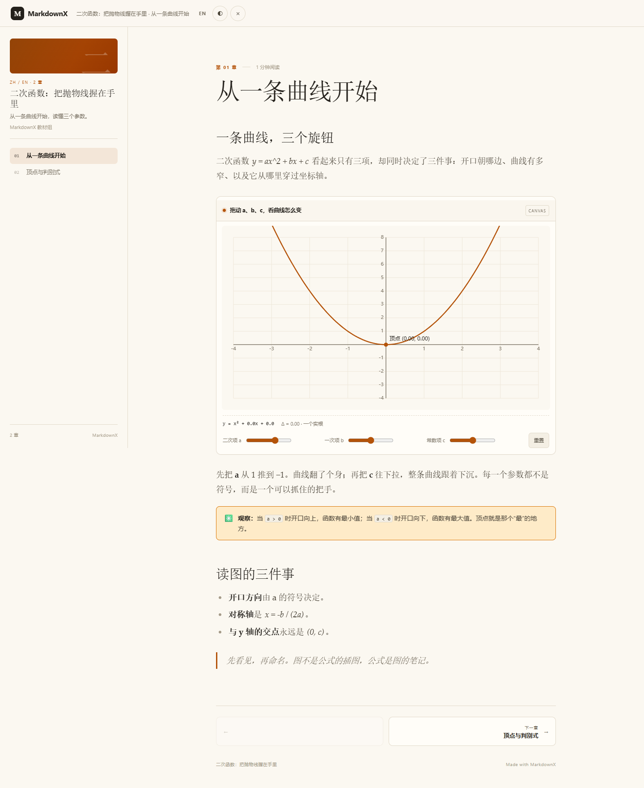

<h1 align="center">MarkdownX</h1>

<p align="center">
  <b>Interactive books, not static pages.</b><br>
  A desktop authoring app and a browser reader for the next generation of learning material.
</p>

<p align="center">
  <a href="https://github.com/neko233-com/MarkdownX/actions/workflows/ci.yml"></a>
  <a href="LICENSE"></a>
  <a href="README-CN.md">简体中文</a>
</p>



## What it is

MarkdownX is a writing and reading environment for **dynamic books**: documents that can contain a draggable parabola, a pendulum you can push, a quiz, a table you can sort, or a whole HTML experiment.

- **Write once, read anywhere.** A book is one `.mdxb` file. Text, images and interactive blocks travel together — no folder of loose assets, no server.
- **Markdown and Feishu/Lark DocxXML.** Chapters can be either format. Existing Markdown imports cleanly; DocxXML keeps its block structure, tables, callouts and colors.
- **Interactive blocks.** `canvas` blocks are declarative JSON (quadratic, unit circle, projectile in the web reader; quadratic natively on the desktop). `html` blocks are sandboxed HTML/JS for everything else.
- **Bilingual by design.** Interface, book metadata and chapter text can carry Chinese and English side by side.
- **A reader that fits the screen.** The web reader is a build-free, responsive page: a single column on a phone, a table of contents and a comfortable measure on a desktop.
- **Local first.** No account, no cloud, no telemetry. The desktop library is a folder you own.
- **A Git repository is a workspace.** Open any folder and MarkdownX widens it to the `.git` root, edits `.md` files in place, and commits each save for the touched file. The sidebar is a directory tree with fuzzy path search and optional full-text search.
- **Built for team workflows.** Game design, product, film and editorial starter templates live in `templates/`; the collaboration server exposes them to the browser. See [docs/WORKFLOWS.md](docs/WORKFLOWS.md).
- **Notes live beside the text.** Temporary comments are stored in `.annotations.json` sidecars, so reviewers can hide, resolve, batch-edit and merge them without touching the prose.
- **Follows your computer.** The first launch follows the system language (Chinese or English) and the setting can pin either one. The app checks the GitHub releases page after launch and every 12 hours, and announces a newer version with its download page.

## Two ways to use it

| Author | Read |
|---|---|
| The GPUI desktop app: open a folder, edit `.md`, insert Canvas/HTML blocks, annotate, then package a `.mdxb`. | The Chrome reader in `web/`: open a `.mdxb`, browse chapters, resize the window, switch language and theme. |

| Landing | Canvas chapter |
|---|---|
|  |  |

## Install a release

The commands below require the corresponding GitHub Release to be published. The current release is a **test pre-release**: the macOS Apple Silicon DMG is ad-hoc signed and not notarized. The in-app update checker follows stable releases and does not announce test pre-releases.

Windows x86_64 (PowerShell 7, current user):

```powershell
irm https://github.com/neko233-com/MarkdownX/releases/download/v0.1.13/install.ps1 | iex
```

macOS arm64 (Apple Silicon):

```sh
curl -fsSL https://github.com/neko233-com/MarkdownX/releases/download/v0.1.13/install.sh | sh -s -- --allow-unsigned
```

The installer verifies the package checksum; Windows requests normal save/exit and preserves the collaboration server and library. macOS installs to `~/Applications/MarkdownX.app`: close an existing copy first. For the unsigned test build, macOS may block the first launch; review the warning and approve opening it in **System Settings → Privacy & Security** if you trust this build. The installer does not change Gatekeeper settings. For offline installs, download the MSI or DMG and its `.sha256`, then use `pwsh -File ./install.ps1 -MsiPath <file>` or `sh ./install.sh --package <file> --allow-unsigned`. Add `-DryRun` or `--dry-run` to inspect without installing. In Windows Git Bash, `sh ./install.sh` delegates to PowerShell 7.

The release workflow never creates or pushes a tag. After a person has reviewed and manually pushed a version tag, run **Actions → Release** with that existing tag and enter `PUBLISH vX.Y.Z` as the confirmation. Both platform builds and checksum checks must pass before the test release is published; a tag push alone does not publish it.

## Quick start

**Requirements:** Rust 1.99.1, and on Windows the Visual Studio 2022 C++ build tools plus a Windows SDK. Python 3 is only needed for the examples and a local web server.

```sh
cargo run --release
```

On Windows, run the build from a Visual Studio developer prompt, or call `vcvars64.bat` first.

To install the built app for the current Windows user, with Start Menu/desktop shortcuts, `.mdxb` registration, and the collaboration server running at sign-in:

```powershell
pwsh -File scripts/install-windows.ps1
```

No administrator rights are needed. The local MSI is preferred. The app goes to `%LOCALAPPDATA%\Programs\MarkdownX`; the server token and workspace remain in `%LOCALAPPDATA%\MarkdownX\server`. The installation is registered in **Apps & features**. The helper refuses to force-close a running installed app or server.

Run `pwsh -File scripts/build-msi.ps1` after the release build to create `dist\MarkdownX-0.1.13-x64.msi`. The MSI installs the app, collaboration server, web UI, templates, shortcuts, `.mdxb` association and the sign-in server launcher; it needs WiX Toolset 3.14 only at build time.

The desktop app creates its library at `~/Documents/MarkdownX` (override with `MARKDOWNX_HOME`). Use **文件 → 打开文件夹…** / **File → Open Folder…** for a Typora-style directory workspace, and **文件 → 打包成电子书…** / **File → Package as E-book…** (`⌘⇧E`) to turn the current folder, or the open Markdown file, into one `.mdxb`. **下载为 → MarkdownX 书 (.mdxb)** exports a library page and its sub-pages. On Windows the installer registers `.mdxb`, so double-clicking a book opens and imports it.

Passing a folder path as the first argument opens its tree without selecting a file. Opening a folder from the menu shows directories and supported files, opens the first file and expands its parent folders. Use **Refresh** after external changes; returning focus to the window also refreshes the tree. Dot-prefixed entries, symlinks, `target`, `node_modules` and `__pycache__` are excluded. Unchanged Markdown source is preserved where possible; unsupported edited constructs may still change; UTF-8 BOM and predominant CRLF line endings are retained. If another program changed the file, or an export would lose detected text, references a missing asset, or conflicts with a different existing asset, MarkdownX keeps the pending edit instead of replacing the source.

**File → Open File…** (`Ctrl+O` on Windows) and a file path argument open Markdown or text files in place, with their folder tree. Use the plus button beside the folder name to create a new Markdown file. Folder saves and link indexing run in the background; switching or closing waits for pending edits to finish. Existing staged changes to the same file prevent Git auto-commit and are reported without undoing the file save.

To read a book in the browser, use the hosted reader at **https://neko233-com.github.io/MarkdownX/web/**, or run it locally:

```sh
python -m http.server 8765 --bind 127.0.0.1
# open http://127.0.0.1:8765/web/
```

The same reader deploys to Vercel with `vercel.json`; `npx vercel deploy` builds `.vercel-out` from `web/` and `examples/` only. A temporary, claimable deployment can be made without an account: `npx vercel deploy --temporary`.

The landing page ships with five examples, including two Chinese middle-school books: **力与运动** (physics) and **物质与变化** (chemistry). You can also drag any `.mdxb` onto the page.

## For agents

A book can be maintained as a folder of `NN-topic.md` chapters. Coding agents can validate and package it without opening the GUI:

```sh
python tools/agent/mdxb.py check examples
python tools/agent/mdxb.py pack books/physics --title "力与运动" -o physics.mdxb
python tools/agent/mdxb.py unpack physics.mdxb books/physics
python tools/agent/mdxb.py search books/physics 速度 --content
```

See [agent/README.md](agent/README.md) for the chapter dialect, annotation sidecar contract and review loop, and [agent/AGENTS.md](agent/AGENTS.md) for rules to give an agent.

## Collaboration server

`server/` is an optional Rust server for teams that want one shared workspace instead of passing `.mdxb` files around. The repository root is the workspace: nested `.md` paths, Chinese filenames and folders are supported, every accepted save is a Git commit, and the browser editor has live presence, history, diff and restore. Point it at a team repo and put it behind TLS on the intranet.

```sh
MARKDOWNX_SERVER_TOKEN=change-me cargo run -p markdownx-server -- \
  -root ./data -web server/web
# open http://127.0.0.1:8877/
```

The editor shows who else is in the room, saves over WebSocket, and resolves stale writes with a three-way merge. Overlapping edits are reported as a conflict with **load latest**, **use merged draft** and **overwrite remote** choices instead of silently dropping text. The history panel reads Git commits, shows a unified diff, and can restore any revision as a new commit. A multi-stage `Dockerfile` is included.

The server is single-tenant and protected by one shared token; put it behind TLS. See [server/README.md](server/README.md) for flags, the HTTP/WebSocket protocol, the conflict model, workspace paths, templates and intranet deployment notes. Workflow conventions are in [docs/WORKFLOWS.md](docs/WORKFLOWS.md).

## The `.mdxb` format

`.mdxb` is a UTF-8 JSON document. The extension is MarkdownX Book; the media type is `application/vnd.markdownx.book+json`.

```json
{
  "format": "markdownx.book",
  "version": 1,
  "id": "quadratics",
  "title": { "zh": "二次函数", "en": "Quadratics" },
  "languages": ["zh", "en"],
  "default_language": "zh",
  "chapters": [
    {
      "id": "chapter-1",
      "title": { "zh": "从一条曲线开始", "en": "Start with a curve" },
      "format": "docxxml",
      "content": "<title>…</title><h1>…</h1>",
      "content_en": "<title>…</title><h1>…</h1>"
    }
  ],
  "assets": {
    "assets/cover.png": { "mime": "image/png", "data": "iVBORw0KGgo…" }
  }
}
```

Every chapter is either `docxxml` or `markdown`; `content_en` is optional and lets the reader switch languages without duplicating the book. Assets are embedded as base64, so a book is genuinely one file.

### Markdown ↔ book

`文件 → 打包成电子书…` turns a folder of Markdown chapters into one `.mdxb`. `下载为 → Markdown 文件夹 (.md)` goes the other way: it writes `NN-title.md` chapters, a same-stem `.xml` DocxXML source per chapter, `book.json` and copied assets beside a small index file. Tables, headings, chapter order and interactive `mdxb-canvas` / `mdxb-html` sources survive; callout tints, grids and other editor-only presentation may degrade to plain Markdown. The XML source keeps the full structure, so packing the folder again recreates the book; if you edit a `.md`, the newer Markdown wins over its XML.

### Interactive blocks in DocxXML

```xml
<interactive type="canvas" title="拖动参数" height="360"><![CDATA[
  {"kind":"quadratic","a":1,"b":0,"c":0,"xMin":-4,"xMax":4,"yMin":-4,"yMax":8}
]]></interactive>
```

```xml
<interactive type="html" title="单摆" height="320"><![CDATA[
  <canvas id="c"></canvas><script>/* sandboxed */</script>
]]></interactive>
```

In Markdown, the same block is a fenced code block with the info string `mdxb-canvas` or `mdxb-html` and a JSON envelope:

````markdown
```mdxb-canvas
{"title":"拖动参数","height":360,"source":"{\"kind\":\"quadratic\",\"a\":1}"}
```
````

The full schema and the round-trip rules are in [docs/FORMAT.md](docs/FORMAT.md).

## Project layout

```
crates/core/        fdl_core: model, DocxXML, Markdown, editor core, .mdxb, library
src/                GPUI desktop app: editor, reader UI, import/export, settings
web/                build-free browser reader (HTML/CSS/ES modules)
server/             Rust collaboration server + browser editor (Git history, diff)
templates/          game, product, film and editorial workflow starters
examples/           five .mdxb books and the Python generators
agent/              book-authoring rules for coding agents
tools/agent/        check, pack, unpack, search, merge-annotations CLI
shared-mock/        built-in guide library and its sources
docs/               architecture, format, themes, performance
```

The document engine does not depend on GPUI, so it can be tested and reused by other front ends. See [docs/ARCHITECTURE.md](docs/ARCHITECTURE.md).

## Build and test

```sh
scripts/check.sh                         # release tests + clippy
cargo test -p fdl_core                   # engine only
FDL_FUZZ_SEEDS=2000 cargo test --release random_edits
```

The web reader has no build step. Run `node --check` on each file under `web/js/` after editing, then open the page through a local server.

The collaboration server is a workspace member:

```sh
cargo test -p markdownx-server
cargo clippy -p markdownx-server --all-targets -- -D warnings
```

## Status

This is an early public snapshot. Working today: the desktop editor and library, a folder workspace with a Typora-style tree and fuzzy/full-text search, direct `.md` editing, Markdown/DocxXML interchange, `.mdxb` import/export and packaging, Markdown-folder export with retained interactive sources, the responsive web reader, Canvas/HTML blocks, `[[wiki links]]`, annotation sidecars with batch resolve/delete, and a self-hosted Rust collaboration server with live presence, three-way merge conflict handling, and Git history/diff/restore. The desktop app runs the built-in `quadratic` Canvas explorer natively; HTML stays sandboxed in the reader. On Windows it falls back to WARP when a hardware D3D11 device is unavailable, so the installed app opens even on VMs and RDP sessions; the fallback is covered by a captured window smoke test. The Windows MSI registers `.mdxb` and starts the collaboration server at sign-in; macOS Info.plist and the Linux MIME package register `.mdxb`, while double-click behavior on macOS/Linux still needs a real desktop check. Mobile shells are a later milestone. See [issues](https://github.com/neko233-com/MarkdownX/issues).

## License

MIT. MarkdownX is a fork of [Quiet.md](https://github.com/s1dashu/quiet-md) by s1dashu; the original copyright notice is kept in [LICENSE](LICENSE). Third-party components, fonts and icons are listed in [THIRD_PARTY.md](THIRD_PARTY.md). Most bundled UI icons are drawn for this project; the Lucide-derived ones are ISC. No Nucleo icons are included.

---

## 简体中文

<h3 align="center">MarkdownX</h3>

<p align="center"><b>书不该只是读到这里。</b><br>给下一代学习者的可交互书本：桌面创作端 + 浏览器阅读端。</p>

### 它是什么

MarkdownX 用来写和读**动态书**：一本可以拖动的抛物线、可以推一把的单摆、可以点的测验、可以排序的表格，或者一整段 HTML 小实验。

- **写一次，到处能读。** 一本书就是一个 `.mdxb` 文件，文字、图片和交互块都在里面，不需要服务器。
- **Markdown 与飞书 DocxXML。** 章节可以是任意一种；Markdown 导入即用，DocxXML 保留标题、表格、高亮块和颜色。
- **交互块。** `canvas` 用声明式 JSON（Web 阅读器有二次函数、单位圆、抛体；桌面原生二次函数）；`html` 用沙箱 iframe 放任意 HTML/JS。
- **原生中英双语。** 界面、书名和章节正文都可以同时带中文和英文。
- **为屏幕而生的阅读器。** 手机单列，桌面目录 + 正文；无构建步骤，Chrome 直接打开。
- **本地优先。** 不登录、不上传、不统计；桌面文档库就是你自己的文件夹。
- **Git 仓库就是工作区。** 打开任意目录，MarkdownX 会向上找到 `.git` 根，目录树直接编辑 `.md`，每次保存只为改动的文件生成一次提交；同一个树里也能放 `.mdxb`。支持模糊路径搜索、内容搜索、`[[双链]]` 和行内批注。
- **团队工作流开箱即用。** `templates/` 里有游戏策划、产品 PRD、影视 treatment、内容选题等模板；浏览器协作端会直接列出这些模板。见 [docs/WORKFLOWS.md](docs/WORKFLOWS.md)。
- **跟着你的电脑走。** 首次启动跟随系统语言（中文/English），也可以在设置里固定一种；应用启动后和每 12 小时检查 GitHub 发布页，发现新版本会提示下载地址。

### 安装发布版

以下命令需要对应 GitHub Release 已发布。当前版本是**测试预发布版**：macOS Apple Silicon DMG 为临时签名，尚未经过 Apple 公证。应用内更新检查只提示正式版，不提示测试预发布版。

Windows x86_64（PowerShell 7，安装到当前用户）：

```powershell
irm https://github.com/neko233-com/MarkdownX/releases/download/v0.1.13/install.ps1 | iex
```

macOS arm64（Apple Silicon）：

```sh
curl -fsSL https://github.com/neko233-com/MarkdownX/releases/download/v0.1.13/install.sh | sh -s -- --allow-unsigned
```

安装脚本会校验安装包；Windows 会请求应用正常保存并退出，保留文档库及协作服务器数据。macOS 安装到 `~/Applications/MarkdownX.app`，请先关闭正在运行的旧版。未公证测试版首次启动时，macOS 可能阻止打开；确认信任后，可在「系统设置 → 隐私与安全性」中检查提示并允许打开。脚本不会修改 Gatekeeper 设置。离线安装时下载 MSI 或 DMG 与其 `.sha256`，运行 `pwsh -File ./install.ps1 -MsiPath <文件>` 或 `sh ./install.sh --package <文件> --allow-unsigned`；添加 `-DryRun` 或 `--dry-run` 可只检查。Windows Git Bash 可通过 `sh ./install.sh` 调用 PowerShell 7。

发布工作流不会创建或推送标签。人工审核并手动推送版本标签后，在 **Actions → Release** 中选择已有标签，并输入 `PUBLISH vX.Y.Z` 确认；Windows 和 macOS 两个平台构建与校验均通过后才发布测试版。仅推送标签不会触发发布。

## 快速开始

需要 Rust 1.99.1；Windows 还需要 Visual Studio 2022 的 C++ 生成工具和 Windows SDK。Python 3 只用于示例和本地静态服务器。

在当前 Windows 用户下安装构建好的版本（开始菜单/桌面快捷方式、`.mdxb` 文件关联、登录时启动协作服务器）：

```powershell
pwsh -File scripts/install-windows.ps1
```

不需要管理员权限。优先使用当前构建的 MSI；应用装到 `%LOCALAPPDATA%\Programs\MarkdownX`，服务器令牌和工作区保留在 `%LOCALAPPDATA%\MarkdownX\server`，并在「应用和功能」中管理。安装脚本不会强制结束运行中的安装版应用或服务器。

release 构建后运行 `pwsh -File scripts/build-msi.ps1`，生成 `dist\MarkdownX-0.1.13-x64.msi`。MSI 会装好应用、协作服务器、Web UI、模板、快捷方式、`.mdxb` 关联和登录启动项；构建时只需要 WiX Toolset 3.14。

```sh
cargo run --release
```

桌面端默认把文档库放在 `~/Documents/MarkdownX`，可用 `MARKDOWNX_HOME` 改。用「下载为 → MarkdownX 书 (.mdxb)」导出当前页及其子页。

启动 MarkdownX 时传入文件夹路径会直接显示目录树，不会自动打开文件。「文件 → 打开文件夹…」会在侧栏显示目录和支持的文件，打开首个文件并展开其上级目录。外部增删文件后可点「刷新」，窗口重新获得焦点时也会刷新。名称以点开头的项、符号链接、`target`、`node_modules` 和 `__pycache__` 不显示。保存时 Markdown 会重新导出，原有排版和未支持的语法可能变化；UTF-8 BOM 和主要的 CRLF 换行会保留。检测到文件已被其他程序修改、导出会丢失标题或正文、资源无法导出或同名资源内容不同时，未保存内容会保留，源文件不会被替换。

「文件 → 打开文件…」（Windows 为 `Ctrl+O`）或启动参数可直接编辑 Markdown 和文本文件，并显示所在目录树；侧栏目录名旁的加号可新建 Markdown 文件。文件保存与双链索引在后台进行，切换或关闭前会等待最新修改保存。若同一文件已有 Git 暂存内容，自动提交会跳过并提示，文件保存结果仍保留。

浏览器阅读：

```sh
python -m http.server 8765 --bind 127.0.0.1
# 打开 http://127.0.0.1:8765/web/
```

首页自带五个示例，也可以把任意 `.mdxb` 拖进页面。

### 格式与交互块

`.mdxb` 是 UTF-8 JSON，扩展名 MarkdownX Book，媒体类型 `application/vnd.markdownx.book+json`。每章是 `docxxml` 或 `markdown`，资源以 base64 内嵌，所以一本书真的只有一个文件。完整字段见 [docs/FORMAT.md](docs/FORMAT.md)。

`文件 → 打包成电子书…` 把 Markdown 章节目录打成一本 `.mdxb`；`下载为 → Markdown 文件夹 (.md)` 反向写出 `NN-title.md`、同名 `.xml` DocxXML 源、`book.json` 和资源。表格、标题、章节顺序、交互块的 `mdxb-canvas` / `mdxb-html` 源码会保留；高亮块颜色、分栏等纯展示细节可能退化成普通 Markdown，但 XML 源保留完整结构，重新打包即可回到书中；如果改过 `.md`，较新的 Markdown 会覆盖较旧的 XML。

DocxXML 里的交互块：

```xml
<interactive type="canvas" title="拖动参数" height="360"><![CDATA[
  {"kind":"quadratic","a":1,"b":0,"c":0}
]]></interactive>
```

Markdown 里则是 `mdxb-canvas` / `mdxb-html` 围栏代码块，正文是一层 JSON 信封。

### 协作服务器

`server/` 是给团队共用一个仓库的可选 Rust 服务器：`-root` 指向 `.git` 所在目录，文档 ID 是仓库相对路径（支持中文文件名和嵌套目录），每次接受的保存都会成为一次 Git 提交，浏览器编辑器里能看见谁在线，并带历史/diff/恢复。

```sh
MARKDOWNX_SERVER_TOKEN=change-me cargo run -p markdownx-server -- \
  -root ./data -web server/web
# 打开 http://127.0.0.1:8877/
```

它支持在线光标/在线成员、WebSocket 保存、三方合并与冲突提示（载入最新、采用合并稿、覆盖远端），版本面板可以看 Git 历史、diff 并把任意版本恢复成一次新提交。附多阶段 `Dockerfile`。服务器是单租户、一个共享令牌，请放在 TLS 反向代理之后；参数、HTTP/WebSocket 协议和部署说明见 [server/README.md](server/README.md)。

### 目录

```
crates/core/        引擎：模型、DocxXML、Markdown、编辑内核、.mdxb、文档库
src/                GPUI 桌面端：编辑、阅读、导入导出、设置
web/                无构建的浏览器阅读器
server/             Rust 协作服务器与浏览器编辑器（Git 历史、diff）
templates/          游戏、产品、影视与内容工作流模板
examples/           五本示例书与生成脚本
agent/              给编码 agent 的写书规则
tools/agent/        check、pack、unpack、search、merge-annotations CLI
shared-mock/        内置指南与源文件
docs/               架构、格式、主题、性能
```

### 构建与测试

```sh
scripts/check.sh
cargo test -p fdl_core
```

协作服务器是 workspace 成员：

```sh
cargo test -p markdownx-server
cargo clippy -p markdownx-server --all-targets -- -D warnings
```

### 状态

这是早期公开快照。现在可用：桌面编辑与文档库、文件夹工作区、Markdown/DocxXML 互转、`.mdxb` 导入导出、Markdown 文件夹导出、批注 sidecar、`[[双链]]`、响应式 Web 阅读器、Canvas/HTML 交互块，以及带 Git 历史和 diff 的 Rust 协作服务器。桌面端原生运行内置的 `quadratic` Canvas 实验；HTML 仍在阅读器里沙箱运行。Windows 在硬件 D3D11 不可用时会自动回退 WARP，VM/RDP 里也能打开桌面 UI，并已用窗口截图冒烟验证。Windows MSI 会注册 `.mdxb` 并在登录时启动协作服务器；macOS Info.plist 和 Linux MIME 包也会注册 `.mdxb`，但双击行为仍待真机验证，移动端壳是下一步。

### 许可

MIT。MarkdownX 源自 s1dashu 的 [Quiet.md](https://github.com/s1dashu/quiet-md)，保留原版权声明；第三方组件、字体与图标见 [THIRD_PARTY.md](THIRD_PARTY.md)。内置界面图标为本项目绘制，随 MIT 发布，不包含 Nucleo 图标。
