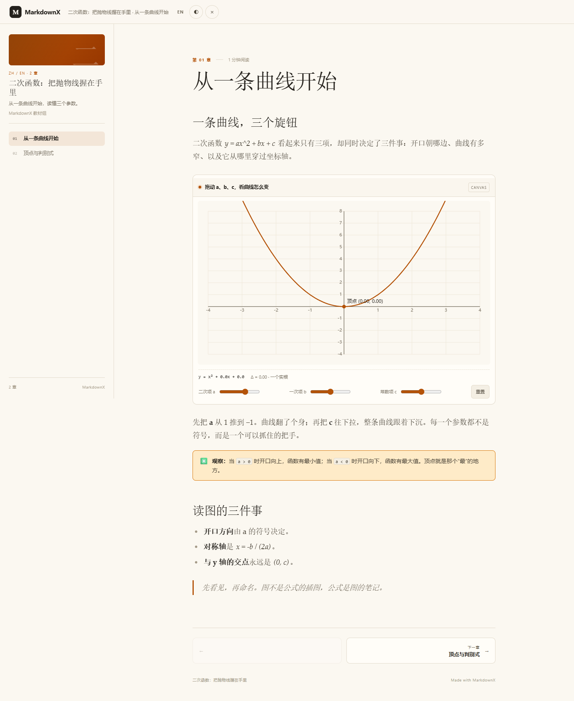
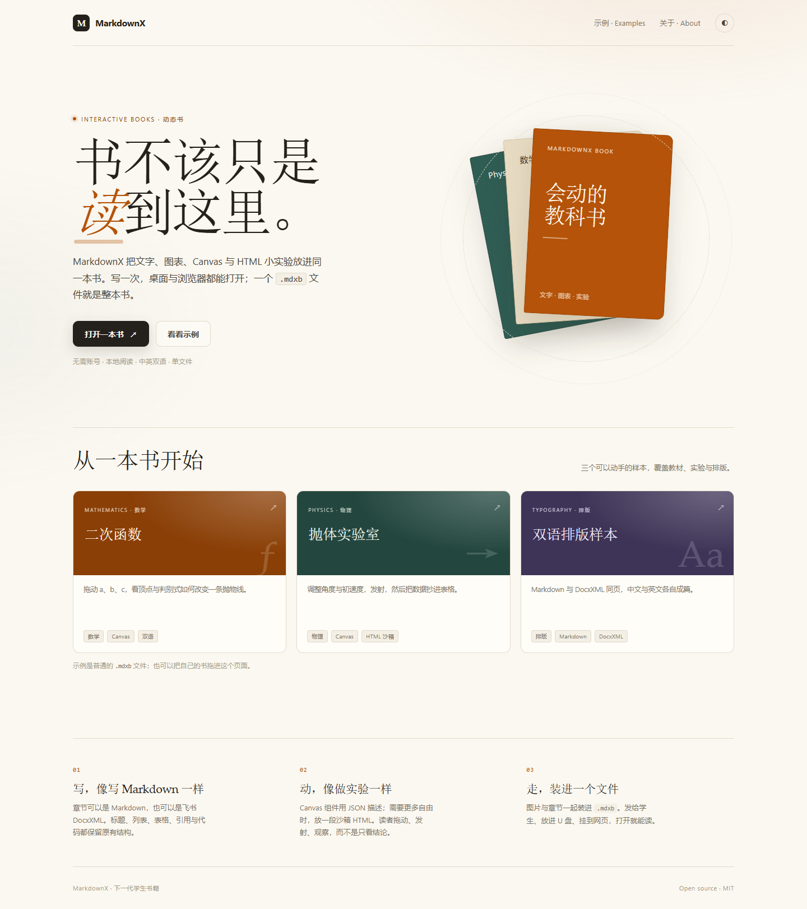

<h1 align="center">MarkdownX</h1>

<p align="center">
  <b>书不该只是读到这里。</b><br>
  给下一代学习者的可交互书本：桌面创作端 + 浏览器阅读端。
</p>

<p align="center">
  <a href="https://github.com/neko233-com/MarkdownX/actions/workflows/ci.yml"></a>
  <a href="LICENSE"></a>
  <a href="README.md">English</a>
</p>



## 它是什么

MarkdownX 用来写和读**动态书**：一本可以拖动的抛物线、可以推一把的单摆、可以点的测验、可以排序的表格，或者一整段 HTML 小实验。

- **写一次，到处能读。** 一本书就是一个 `.mdxb` 文件，文字、图片和交互块都在里面，不需要服务器，也不怕资源散落。
- **Markdown 与飞书 DocxXML。** 章节可以是任意一种；Markdown 导入即用，DocxXML 保留标题、表格、高亮块和颜色。
- **交互块。** `canvas` 用声明式 JSON（Web 阅读器有二次函数、单位圆、抛体；桌面原生二次函数）；`html` 用沙箱 iframe 放任意 HTML/JS。
- **原生中英双语。** 界面、书名和章节正文都可以同时带中文和英文。
- **为屏幕而生的阅读器。** 手机单列，桌面目录 + 正文；无构建步骤，Chrome 直接打开。
- **本地优先。** 不登录、不上传、不统计；桌面文档库就是你自己的文件夹。

## 两种用法

| 创作 | 阅读 |
|---|---|
| GPUI 桌面端：写章节、插入 Canvas/HTML、导出 `.mdxb`。 | `web/` 里的 Chrome 阅读器：打开书、翻章、缩放窗口、切换语言和主题。 |

| 首页 | 可交互章节 |
|---|---|
|  |  |

## 快速开始

需要 Rust 1.99.1；Windows 还需要 Visual Studio 2022 的 C++ 生成工具和 Windows SDK。Python 3 只用于示例和本地静态服务器。

```sh
cargo run --release
```

Windows 请在 Visual Studio 开发者命令行里构建，或先调用 `vcvars64.bat`。

桌面端默认把文档库放在 `~/Documents/MarkdownX`，可用 `MARKDOWNX_HOME` 改。用「下载为 → MarkdownX 书 (.mdxb)」导出当前页及其子页。

浏览器阅读：

```sh
python -m http.server 8765 --bind 127.0.0.1
# 打开 http://127.0.0.1:8765/web/
```

首页自带三个示例，也可以把任意 `.mdxb` 拖进页面。

## `.mdxb` 格式

`.mdxb` 是 UTF-8 JSON，扩展名 MarkdownX Book，媒体类型 `application/vnd.markdownx.book+json`。

```json
{
  "format": "markdownx.book",
  "version": 1,
  "id": "quadratics",
  "title": { "zh": "二次函数", "en": "Quadratics" },
  "languages": ["zh", "en"],
  "default_language": "zh",
  "chapters": [
    {
      "id": "chapter-1",
      "title": { "zh": "从一条曲线开始", "en": "Start with a curve" },
      "format": "docxxml",
      "content": "<title>…</title><h1>…</h1>",
      "content_en": "<title>…</title><h1>…</h1>"
    }
  ],
  "assets": {
    "assets/cover.png": { "mime": "image/png", "data": "iVBORw0KGgo…" }
  }
}
```

每章是 `docxxml` 或 `markdown`；`content_en` 可选，让阅读器在不复制整本书的情况下切换语言。资源以 base64 内嵌，所以一本书真的只有一个文件。完整字段见 [docs/FORMAT.md](docs/FORMAT.md)。

### DocxXML 里的交互块

```xml
<interactive type="canvas" title="拖动参数" height="360"><![CDATA[
  {"kind":"quadratic","a":1,"b":0,"c":0,"xMin":-4,"xMax":4,"yMin":-4,"yMax":8}
]]></interactive>
```

```xml
<interactive type="html" title="单摆" height="320"><![CDATA[
  <canvas id="c"></canvas><script>/* sandboxed */</script>
]]></interactive>
```

Markdown 里则是 `mdxb-canvas` / `mdxb-html` 围栏代码块，正文是一层 JSON 信封：

````markdown
```mdxb-canvas
{"title":"拖动参数","height":360,"source":"{\"kind\":\"quadratic\",\"a\":1}"}
```
````

## 目录

```
crates/core/        引擎：模型、DocxXML、Markdown、编辑内核、.mdxb、文档库
src/                GPUI 桌面端：编辑、阅读、导入导出、设置
web/                无构建的浏览器阅读器（HTML/CSS/ES modules）
examples/           三本示例书与生成脚本
shared-mock/        内置指南与源文件
docs/               架构、格式、主题、性能
```

文档引擎不依赖 GPUI，所以可以单独测试，也可以给别的前端复用。见 [docs/ARCHITECTURE.md](docs/ARCHITECTURE.md)。

## 构建与测试

```sh
scripts/check.sh                         # release 测试 + clippy
cargo test -p fdl_core                   # 只测引擎
FDL_FUZZ_SEEDS=2000 cargo test --release random_edits
```

Web 阅读器没有构建步骤。改完 `web/js/` 后对每个文件跑 `node --check`，再用本地服务器打开页面。

## 状态

这是早期公开快照。现在可用：桌面编辑与文档库、Markdown/DocxXML 互转、`.mdxb` 导入导出、响应式 Web 阅读器、Canvas/HTML 交互块。桌面端原生运行内置的 `quadratic` Canvas 实验；HTML 仍在阅读器里沙箱运行。系统文件关联和移动端壳是下一步。见 [issues](https://github.com/neko233-com/MarkdownX/issues)。

## 许可

MIT。MarkdownX 源自 s1dashu 的 [Quiet.md](https://github.com/s1dashu/quiet-md)，保留原版权声明；第三方组件、字体与图标见 [THIRD_PARTY.md](THIRD_PARTY.md)。内置界面图标为本项目绘制，随 MIT 发布，不包含 Nucleo 图标。
